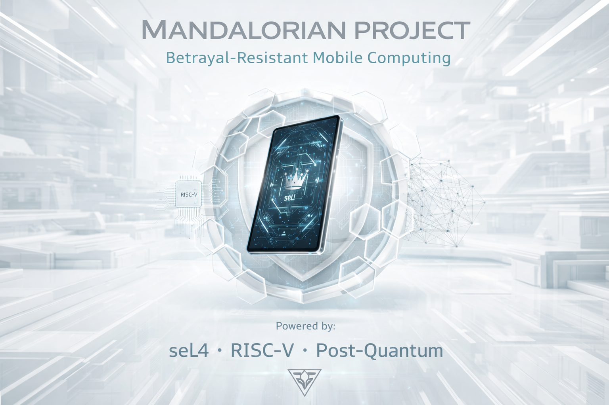
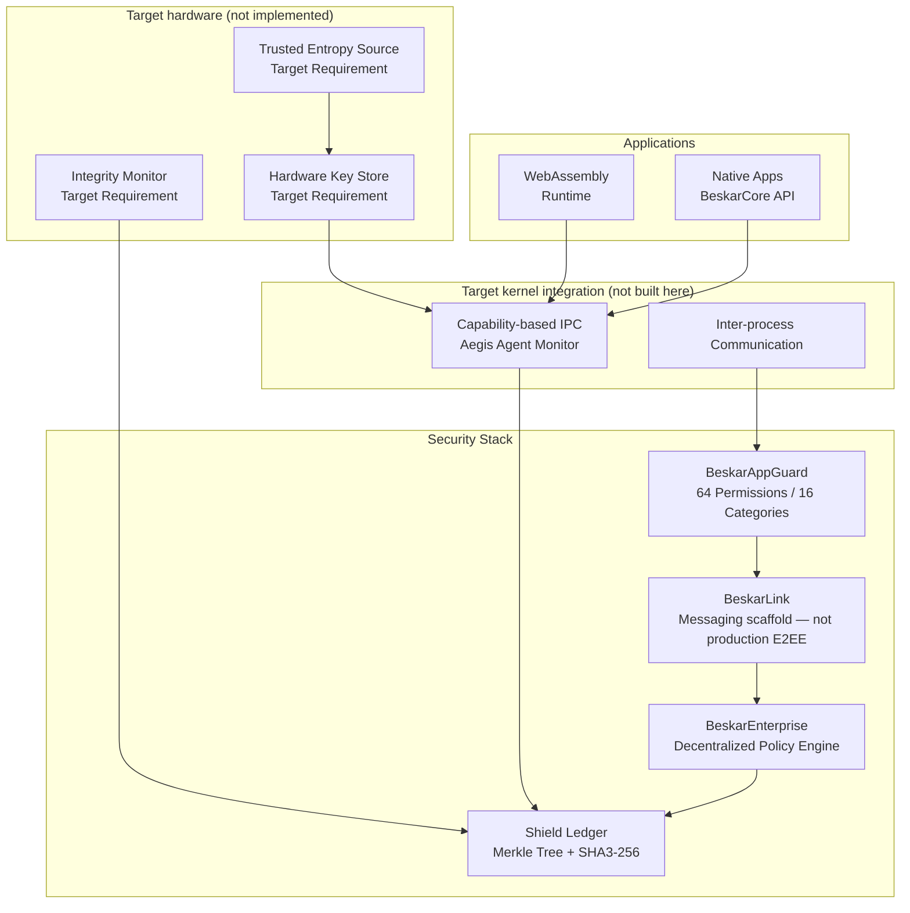

[](https://github.com/iamGodofall/mandalorian-project/actions/workflows/ci.yml)
[](LICENSE)
[](https://github.com/seL4/seL4)
[](https://iamgodofall.github.io/mandalorian-project/)

---

# Mandalorian Project — Sovereign Mobile Computing

**Research prototype for capability-oriented, sovereignty-focused computing**

> *"Sovereignty is not a feature — it is the foundation."*

The Mandalorian Project is a research and development effort exploring a sovereignty-focused mobile computing architecture. The repository contains a host-buildable C prototype, policy and capability experiments, cryptographic primitives, architecture scaffolding, and a seL4-oriented target design. It does **not** currently deliver a secure mobile operating system, a formally verified end-to-end platform, hardware-backed isolation, or a system proven resistant to coercion or physical capture.

**Live documentation:** [https://iamgodofall.github.io/mandalorian-project/](https://iamgodofall.github.io/mandalorian-project/)

---

## The Problem

The project investigates how a mobile platform could reduce unnecessary trust in vendors and remote services. The following are **design goals, not current guarantees**:

- **Target:** sensitive operations require explicit, auditable authorization.
- **Target:** audit evidence is integrity-protected and eventually durable, with externally verifiable checkpoints.
- **Target:** hardware-backed integrity and key protection work without a cloud dependency.
- **Target:** critical components have reproducible builds, defined verification evidence, and independent review.

---

## Target Architecture (Not Yet Delivered)



### Security Guarantees

These are design goals. The right-hand column says what the code in this
repository does *today*, which is not the same thing — see the status column
before relying on any row.

| Goal | Status | What is actually implemented |
|---|---|---|
| **No backdoors** | Design goal only | The host gate does not require a central server, but this does not establish a no-backdoor property. The library is not an OS-enforced boundary. |
| **Capability enforcement** | Host prototype | HMAC-SHA3-256 authentication, lexical resource checks, size constraints, policy, replay guard, and audited decisions for well-formed requests. `GATE_SIMULATED` means no file operation occurred; this is not OS confinement. |
| **Hash-chained audit ledger** | Partial | Shield Ledger chains entries with SHA3-256 in bounded process-local memory. It is not crash-durable or independently tamper-proof. |
| **Hash integrity** | Primitive tested | SHA3-256/512 pass the repository’s FIPS 202 known-answer vectors. This does not validate every use of cryptography across the full project. |
| **Key destruction on tamper** | Not implemented | Requires the tamper mesh and custom PCB described under Hardware Reality Check. |
| **Secret hygiene** | Partial | Key material is wiped with `secure_zero()`, which the compiler cannot optimise away. Keys still live in ordinary application RAM — a real HSM never exposes them, which needs the hardware in Phase 2. |
| **Forward secrecy / messaging** | Not established | BeskarLink is incomplete and is not the Signal Double Ratchet. Do not use it for production end-to-end encryption. Reviewed protocol integration and conformance testing are required. |
| **Message encryption** | Placeholder | BeskarLink uses a SHA3-based keystream with a SHA3 MAC, not a reviewed AEAD. Do not use it to protect real messages. |
| **Post-quantum resistance** | Not implemented | No CRYSTALS-Dilithium, Kyber, or any PQC primitive exists in this repository. |
| **Continuous integrity** | Simulated prototype | Software checks exercise simulated regions; there is no demonstrated hardware watchdog or ROM-resident trust anchor. |
| **Random number generation** | Working | All key, nonce and identifier material comes from the OS CSPRNG (`getrandom(2)`, `arc4random_buf`, `BCryptGenRandom`, or `/dev/urandom`) via `secure_random.h`, which **fails closed** — no entropy source means an error, never a weak fallback. Covered by `tests/unit/test_secure_random.c`, which fails against the previous clock-seeded implementation. |

---

## System Components

| Component | Name | Purpose | Status |
|-----------|------|---------|--------|
| **Device** | Mandalorian Phone | Sovereignty-focused mobile platform concept | No complete phone or target board integration demonstrated |
| **Core OS** | BeskarCore | Capability-oriented OS foundation | Host components and target scaffolding; no demonstrated seL4 deployment |
| **Attestation** | Helm | Device measurement and policy concept | Host scaffold; no demonstrated post-quantum or hardware attestation |
| **Privacy Agent** | Aegis | IPC monitoring and consent enforcement concept | Target integration not demonstrated |
| **Runtime** | WebAssembly | Cross-platform app execution concept | Partial scaffolding; not a complete device runtime |

---

## Hardware Reality Check

| Component | Production-Ready? | Notes |
|-----------|-------------------|-------|
| RISC-V smartphone SoC | No | VisionFive 2 is Linux SBC only — no cellular baseband, no secure enclave |
| OTP key fusing | No | Requires custom silicon (Phase 3) |
| Tamper mesh | No | Requires custom PCB (Phase 2) |
| Memory encryption | No | Custom silicon required (Phase 3) |

> VisionFive 2 can support software development and architectural experiments, but it is not a secure phone platform. Hardware-backed claims require target integration and independent validation; a real OS-enforced execution boundary is a separate prerequisite.

---

## Getting Started

### Prerequisites

```bash
sudo apt install build-essential cmake
```

### Build and test

The host build covers BeskarCore, Helm, Aegis, VeridianOS and the Mandalorian
gate, with their demos and tests. It needs only a C compiler and CMake — there
is no libsodium or cmocka dependency for the default build.

```bash
git clone --recurse-submodules https://github.com/iamGodofall/mandalorian-project.git
cd mandalorian-project
cmake -B build -DCMAKE_BUILD_TYPE=Release
cmake --build build --parallel
ctest --test-dir build --output-on-failure
```

To build with AddressSanitizer and UBSan:

```bash
cmake -B build-asan -DCMAKE_BUILD_TYPE=Debug -DENABLE_SANITIZERS=ON
cmake --build build-asan --parallel
ctest --test-dir build-asan --output-on-failure
```

### Run the demos

```bash
./build/mandalorian/constrained-agent-demo   # capability gate, replay protection and audit receipts
./build/beskarcore/demo                      # SHA3-256 + Merkle ledger
./build/beskarcore/demo_continuous_guardian  # Continuous Guardian
./build/beskarcore/demo_beskar_vault         # HSM key lifecycle
./build/beskarcore/demo_beskar_link          # secure messaging
./build/beskarcore/demo_beskar_enterprise    # decentralised policy
./build/helm/demo_helm                       # attestation
```

### Target build (seL4 + CAmkES)

The RISC-V/seL4 image is built separately and needs the seL4 toolchain:

```bash
cd beskarcore
make deps
make simulate
make run_simulate
```

---

## Documentation

Full documentation is live at **https://iamGodofall.github.io/mandalorian-project/**

| Section | Contents |
|---------|----------|
| [Architecture](https://iamgodofall.github.io/mandalorian-project/architecture/overview/) | Gate, Helm, Vault, Link, Shield Ledger |
| [Security](https://iamgodofall.github.io/mandalorian-project/security/) | Audit findings, critical fixes, bypass resistance |
| [API Reference](https://iamgodofall.github.io/mandalorian-project/api/) | Full API documentation |
| [FOSDEM 2026 Talk](https://iamgodofall.github.io/mandalorian-project/fosdem2026_talk_outline/) | Presentation outline and abstract |
| [Security posture and threat model](docs/security/SECURITY_POSTURE_2026-10.md) | Trust boundaries, code-review findings, release gates, and evidence limits |
| [Security policy](SECURITY.md) | Private vulnerability reporting and safe testing guidance |

---

## Licensing

| Tier | License | Price | Best For |
|------|---------|-------|----------|
| **Source-available** | Mandalorian Sovereignty License | Free under its custom terms | Individuals and researchers |
| **Startup** | Commercial agreement | From $10,000/year | Defined proprietary use rights and support scope |
| **Growth** | Commercial agreement | From $50,000/year | Expanded rights and contracted integration |
| **Enterprise** | Commercial agreement | From $250,000/year | Contracted organization-wide rights and support |
| **Sovereign / government** | Custom agreement | Quoted by scope | Feasibility assessment and contracted engineering |

The published license is a **custom source-available license, not an OSI-approved open-source license**. Commercial prices are starting points in a draft offering, not a binding quotation or a promise of production capability. Only the rights and deliverables in a signed agreement apply. [See the licensing draft.](COMMERCIAL_LICENSE.md)

---

## Contributing

Security-sensitive contributions should include focused adversarial tests, known-answer vectors where applicable, sanitizer coverage, and explicit failure behavior. Dudect timing analysis, Frama-C/ACSL proofs, and bit-for-bit reproducible builds are release goals where applicable, not claims that the current CI already proves them.

[See full contributing guidelines.](CONTRIBUTING.md)

---

## Acknowledgments

- [seL4](https://github.com/seL4/seL4) — target architecture reference; no integrated target is demonstrated here
- [Signal Protocol](https://signal.org/docs/) — candidate protocol reference for future reviewed messaging work; not integrated
- [HACL*](https://hacl-star.github.io/) — candidate reference for vetted cryptographic implementation; not claimed as a dependency
- [OpenTitan](https://github.com/lowRISC/opentitan) — reference for transparent silicon and root-of-trust design

---

*Last updated: October 20, 2026*  
*Repository: [https://github.com/iamGodofall/mandalorian-project](https://github.com/iamGodofall/mandalorian-project)*  
*Documentation: [https://iamgodofall.github.io/mandalorian-project/](https://iamgodofall.github.io/mandalorian-project/)*  
*Contact: info@socialfeed.co.za or landinwest@gmail.com*
